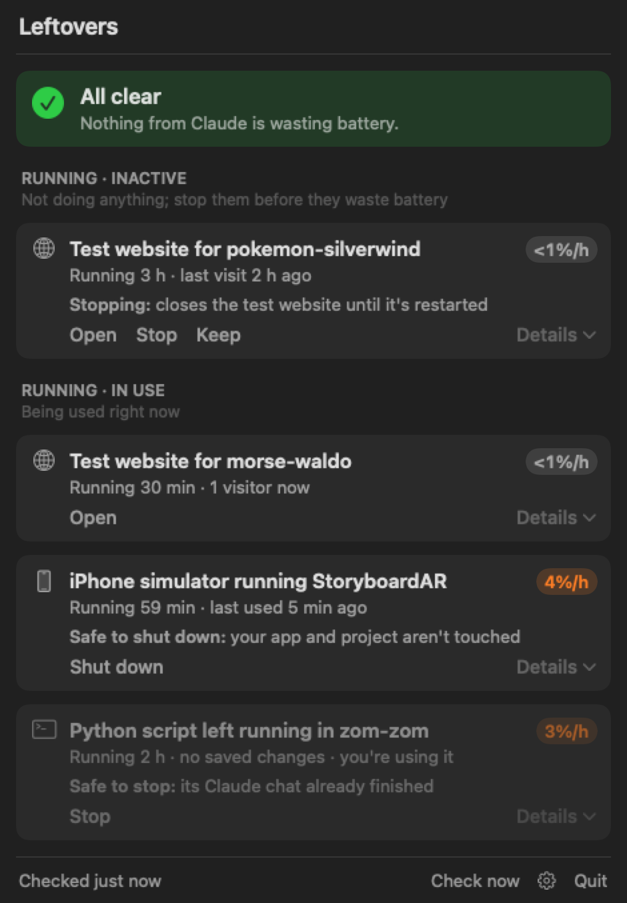
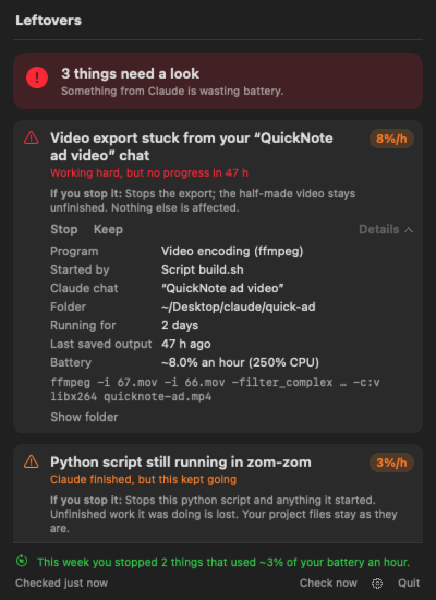
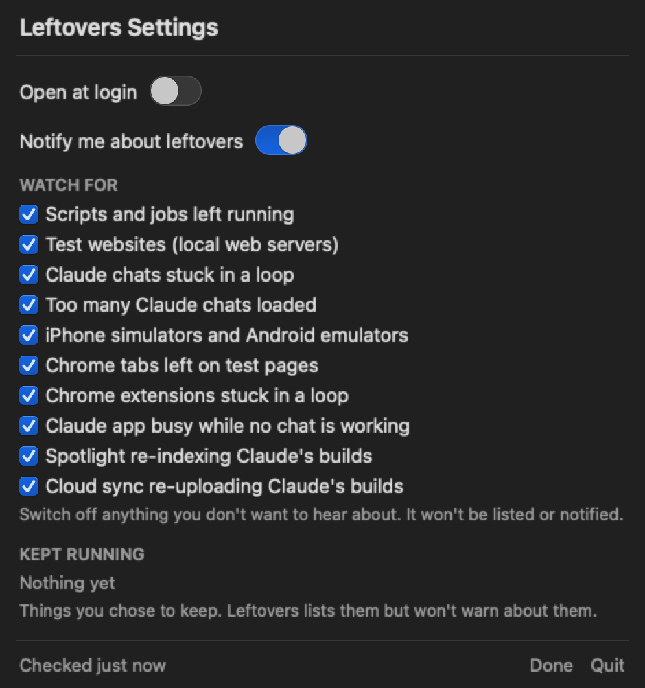

# Leftovers

A tiny Mac menu-bar app that spots things Claude left running and draining your battery, then stops them with one click.

Its menu bar icon is a takeout box with chopsticks. A small **orange dot** means something needs a look; a **red dot** means something is stuck.





## Why

Claude Code often starts background work: builds, video encodes, dev servers, iPhone simulators. When a session ends, some of that work can keep running with nothing watching it. Leftovers was written after a video encode had been stuck for **two days** at full power and two simulators had been running for over a day. Nothing had warned about any of it.

## What it shows

At the top there's always a clear answer: a green **All clear**, or **"2 things need a look"** in orange or red. Problems come first, then two quieter lists: **Running · inactive** (nothing is using it; stop it before it wastes battery) and **Running · in use**.

Each row's icon shows what kind of thing it is (↻ stuck in a loop, terminal = script, hammer = build, globe = test website, phone = simulator, and so on), and its color shows how serious it is.

Every row reads the same way:
- **Title:** what it is, in plain words, e.g. *"Python script stuck in zom-zom"* or *"iPhone simulator running StoryboardAR"*.
- **Subheader:** how long it's been going and when it last did something, e.g. *"Running 2 days · last change 47 h ago"* or *"Busy 20 min · last message 3 h ago"*.
- **One line on what stopping does:** *"Safe to stop: its Claude chat already finished"* or *"Stopping: closes the test website until it's restarted"*. When there's nothing to stop, it gives the fix instead.
- **Details** for the technical facts: program, the script that started it, Claude chat, folder, command, battery cost.

| Section | What it means | Buttons |
|---|---|---|
| **Left behind** | Its Claude session is gone, but the process is still running. Shows which session left it. | Stop · Keep |
| **Simulators** | Booted iPhone/iPad simulators, and which app each one is running. | Shut down · Keep |
| **Started by the Claude app** / **Running in a Claude session** | Dev/preview servers, with whether anyone is connected. | Open · Stop |
| **Android emulators** | Treated like iPhone simulators. | Shut down · Keep |
| **Chrome tabs** | Tabs showing Claude's test pages (localhost or project files), when you haven't used Chrome for a while. | Close tab · Keep |
| **Claude app previews** | The Claude app drawing hard while no chat is working, usually an animated preview or artifact left open. | Open Claude |
| **Spotlight** | Spotlight busy indexing Claude's freshly made build folders (node_modules, .build…). | Open Spotlight settings |
| **Cloud sync** | iCloud/OneDrive/Dropbox busy uploading Claude's build folders. | Show folder |
| **Claude chat stuck in a loop** | A chat's helper program says it's idle but keeps the CPU busy (a known Claude Code bug). | Close |
| **Too many chats loaded** | 15 or more chat helpers loaded at once. Claude pre-loads at most 6 on its own, but every chat you open stays loaded until memory runs low, and a known bug has let them reach 150. | (fix shown) |
| **Chrome extension spinning** | A Chrome extension busy in the background for 10+ minutes (Claude in Chrome has had this bug). | Open Chrome extensions |


Every row shows its **battery cost** as a share of your battery per hour (e.g. `8%/h`), worked out from the energy macOS measures for each process.

## When it warns you

It warns you only when something is both **unowned** (its Claude session has ended) and **unused** (not making progress, nobody connected, not being looked at). Busy is not enough on its own.

| | When | Example |
|---|---|---|
| 🔴 | Working hard for 30+ min but its output files haven't changed for 30+ min | "ffmpeg looks stuck" |
| 🟠 | Still busy 10+ min after its session ended | "A leftover from Claude is still running" |
| 🟠 | A simulator running 2+ h without being used | "iPhone 17 is running unused" |
| ⚪ | A dev server nobody has connected to for 1+ h | shown in the menu only |

On battery, all waits are cut in half. Each problem is announced once, with **Stop**, **Keep running** and **Remind me in an hour** buttons. When you unplug, you get one summary of anything still running.

**It never stops anything without a click.** Stop asks the process to quit, waits 5 seconds, then forces it if needed. It also stops the script that started it, so nothing starts again. **Keep** is remembered for that project and command.

**Settings → Watch for** lets you switch off any kind of check (say, Spotlight, if you'd rather keep it indexing); switched-off checks are never listed or notified.

## Privacy & permissions

- Fully offline. It reads the process list, battery info and the Claude app's session titles on your Mac. Nothing leaves the computer.
- Permissions (standard macOS prompts): notifications; Chrome tab addresses (only while Chrome is open, for the tab check); Desktop folder dates (only when Spotlight or cloud sync is busy).
- It only looks at what Claude started. It finds Claude's chats by the program itself, wherever they run, and follows everything each chat starts. It **remembers** what each chat started, so a leftover is still recognised after the chat closes, in any folder. As a backup it also checks Claude's scratch folders and the folders Claude's own records say your chats worked in. There's nothing to set up, and it never touches your normal apps.
- It's very light: about 0.02% of the battery per hour. It checks every minute on battery and every 3 minutes when plugged in.



## Build

Needs the Swift toolchain (Xcode or Command Line Tools); no Xcode project.

```bash
./build.sh      # builds Leftovers.app, installs it to /Applications and launches it
                # signs with $SIGN_IDENTITY, a .signing-identity file, your first code-signing certificate, or ad-hoc
swift test      # alarm-rule and classification tests
```

Testing helpers: `Leftovers --once` prints one scan as JSON, `Leftovers --render-demo out.png [--settings]` draws the README pictures, `Leftovers --stop <title>` stops a matching leftover, and `defaults write com.danielryan.Leftovers ruleSpeedup -float 60` makes every wait 60× shorter (delete it afterwards).

## License

MIT
