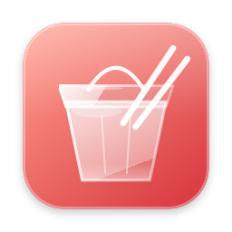
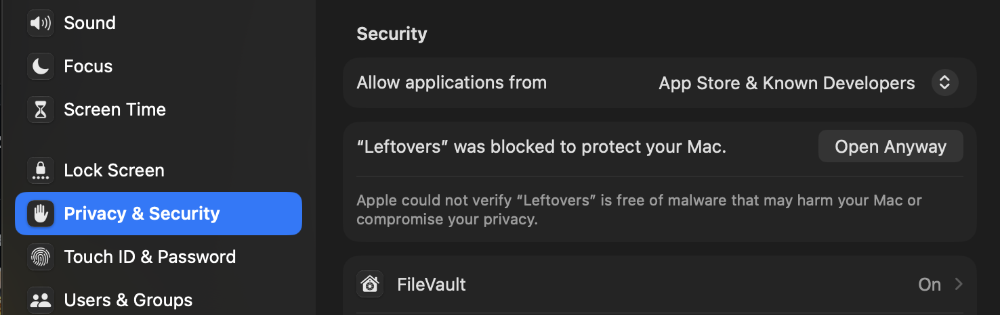

# Leftovers



**A tiny Mac menu bar app that spots things Claude left running and draining your battery, and stops them in one click.**


### [⬇️ Download Leftovers](https://github.com/hi-dad/leftovers/releases/latest/download/Leftovers.dmg)
Free · macOS 14 or newer · needs the Claude desktop app · always the latest version

⚠️ **The first time you open it, macOS blocks it.** That's normal for free apps outside the App Store. [See step 2 below](#install) for the one click that lets it open.

## Install

1. Open **Leftovers.dmg** and drag Leftovers into **Applications**.
2. Open it. When macOS says it can't verify the app, go to **System Settings → Privacy & Security** and click **Open Anyway** (once).

   

3. Allow notifications.

A takeout box appears in your menu bar. An **orange dot** means something's idle; a **red dot** means something's stuck.

## What it catches

- Scripts, builds and video exports Claude left running after a chat ended
- Test websites nobody is using
- iPhone simulators and Android emulators left on
- Claude chats stuck in a loop, or too many loaded at once
- Videos or animations left playing in Claude, or Claude busy while no chat is working
- Spotlight or cloud sync busy with Claude's build folders

Each one shows what it is, how long it's been running, its battery cost per hour, and what stopping it does.

## Safe by design

- **Never stops anything without your click.** **Ignore** hides it until its next run.
- **Only watches what Claude started.** Your normal apps are never touched.
- **Fully offline and very light:** about 0.02% of your battery an hour.
- Choose what it watches in **Settings**.

**Update:** download again and replace the app. **Remove:** quit it from its menu and drag it to the Trash.

<details><summary>Build it yourself</summary>

Needs Xcode or the Command Line Tools.

```bash
./build.sh     # builds, installs to Applications and opens it
swift test     # runs the tests
```

`Leftovers --render-demo out.png [--settings | --scenario <name>]` draws the README pictures.

</details>

MIT License
